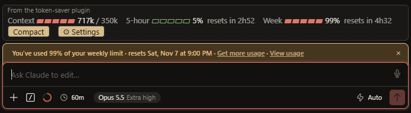

<p align="center">
  
</p>

<h1 align="center">Token Saver</h1>

<p align="center">
  <em>Your weekly Claude Code limit, stretched.</em>
</p>

<p align="center">
  
  
  
  
</p>

<p align="center">
  <a href="https://felixforlyfe.github.io/token-saver/"><strong>Website</strong></a> &middot;
  <a href="#install"><strong>Install</strong></a> &middot;
  <a href="#what-it-does"><strong>What it does</strong></a> &middot;
  <a href="#find-what-fills-your-context"><strong>Find what fills your context</strong></a>
</p>

<p align="center">
  
</p>

Long sessions get more expensive on every turn, because the whole conversation is re-read each time. Token Saver compacts early, hands routine steps to a cheaper model, caps runaway effort, and keeps a usage bar above your prompt so you always know where you stand.

> It hasn't been benchmarked, so treat any saving as an estimate. For long sessions most of it comes from compaction.

## Install

At the prompt of a Claude Code session:

```
/plugin install token-saver --marketplace FelixForLyfe/token-saver
```

Or from a shell:

```
claude plugin install token-saver --marketplace FelixForLyfe/token-saver
```

Then set the `notesDir` plugin setting to a folder that exists on your machine. The default is `D:/Claude/token-saver-notes`, which only works with a D: drive.

## What it does

| | |
| --- | --- |
| **Compacts early** | Once the context passes your threshold (default 200k, presets to 500k, or type your own), it compacts after the turn ends. |
| **Keeps a notes file** | Each compaction saves its summary, and the system prompt points Claude at the file afterwards, so less is lost. |
| **Cheaper routine steps** | Planning stays on your chosen model. Follow-up steps run on Sonnet or Haiku. Boost turns this off for hard work. |
| **Caps effort** | Reasoning effort is held at high unless you set it to Free. |
| **Trims subagents** | Subagents default to a cheaper model, and the fork guard refuses to copy a huge conversation into one. |
| **Paces your week** | A note appears when weekly usage runs ahead of an even seven-day pace. |
| **Usage bar** | Context, 5-hour and weekly meters with a Settings menu. `/saver` prints the full report in chat. |

## Settings

Click **⚙ Settings** on the bar. The selected option in each row shows as `[● choice]`.

| Setting | Choices |
| --- | --- |
| Effort | Capped (high), Free |
| Boost | Off, On (next turn only) |
| Routine steps | Sonnet, Haiku, Off |
| Auto-compact | 100k, 150k, 200k, 250k, 500k, off, or your own value in k |
| Subagents | sonnet, haiku, opus, inherit |
| Fork guard | On, Off |
| Notes file | On, Off |

## Find what fills your context

Most of a fresh session is fixed overhead, not your messages.

- `/saver-load` lists what the window carries before you type: system prompt, connectors, skills and memory files, with token counts.
- `/saver-off <folder>` moves a skill folder from `~/.claude/skills` to `D:\Claude\skills-off`, and `/saver-on <folder>` moves it back. Nothing is deleted. Run `/reload-plugins` afterwards.
- A mod can't switch connectors. Turn them off in the app's connector settings.

## Plays well with others

Other mods can draw above the prompt too. Token Saver stacks with them instead of replacing them, separates the bands with a rule, and namespaces its buttons so keyboard focus never clashes. Tested alongside [Ponytail](https://github.com/DietrichGebert/ponytail): Ponytail changes how Claude writes, Token Saver changes how it runs.

## Limits

- Sonnet on routine steps is a little less careful than Opus, and any compaction can drop a detail. For hard work press Boost, set Effort to Free, or set Routine steps to Off.
- Plugins and their settings are stored per computer. Install it once on each machine.
- Built and used in the desktop app's Code tab, and it also loads in the Linen IDE. The terminal and VS Code haven't been tested.
- A mod can't replace the built-in `/usage`, so `/saver` and the Settings panel show the extra detail.

## License

MIT, see [LICENSE](LICENSE). Contributions welcome.
